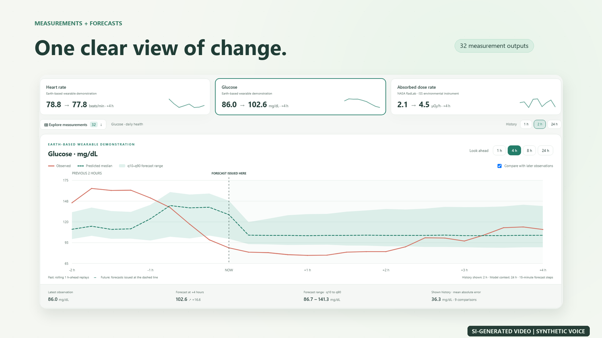
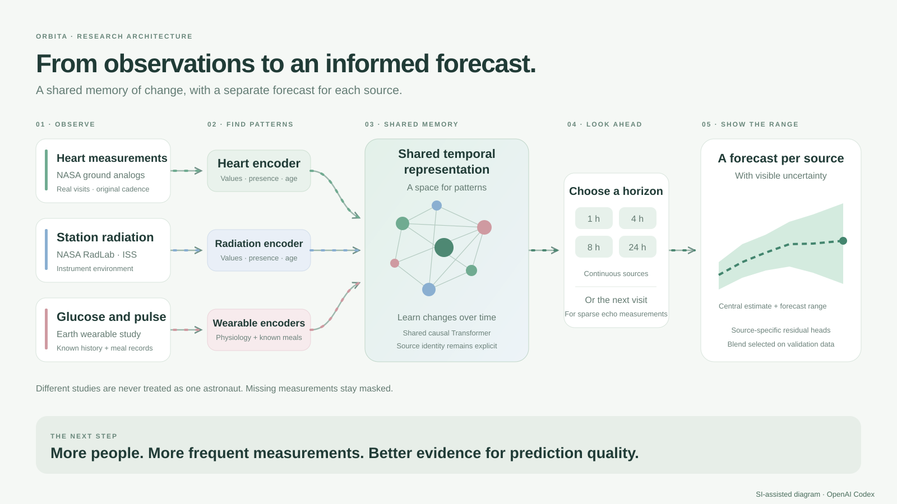

# ORBITA

### Predictive digital twin with chatbot assistance

A research prototype for future crew health support, developed by **ViMas Tech** for NASA Space Apps 2026.

**[Explore the dashboard](https://eric-mas03.github.io/ORBITA/)** · **[Watch the 30-second film](https://eric-mas03.github.io/ORBITA/demo.html)** · **[Open / download the video on GitHub](demo/ORBITA.mp4)**



ORBITA compares earlier forecasts with real observations, then shows what may happen next — with uncertainty. It combines a shared temporal forecasting model, an approachable dashboard and a research assistant that connects to **the visitor's own** Codex, Claude Code or OpenCode account.

This is a **retrospective research demonstration**, not live astronaut telemetry or a clinically validated decision system.

## What you can explore

- 32 study-specific measurement outputs, searchable by signal and source.
- Independent history controls (1 / 2 / 24 h) and look-ahead controls (1 / 4 / 8 / 24 h).
- Genuine trained quarter-hour queries through +24 h for continuous sources; sparse cardiac measurements remain visit-based.
- Observations, earlier rolling forecasts, a visible forecast origin, q50 and continuous q10–q90 bands.
- Per-measurement comparisons, forecast tables, historical error and observed range coverage.
- Light/dark themes, a responsive layout and a full-height research-assistant panel.

The hosted dashboard uses a frozen held-out research replay. Its controls work without installing Python. The Python inference code and frozen checkpoint are included so the predictions can also be reproduced locally.

## Chat uses your account

**Chat starts disconnected. No author account, provider API key, token or browser session is published.** To use it, sign in to your own supported CLI, start the local connector and pair the page with the code it prints. The connector checks local sign-in; before connection, chat input and shortcuts are disabled. A reload or disconnect clears the pairing from page memory.

```sh
# Example: use your own Codex account
codex login
python scripts/local_agent_bridge.py --provider codex
```

Claude Code and OpenCode are supported through the same local connector. See **[personal assistant setup](docs/PERSONAL_ASSISTANT.md)**. Provider credentials stay on the visitor's computer; normal account usage limits apply. The assistant explains research evidence and uncertainty, not validated treatment or causal food/exercise effects.

## NASA data and independent evidence streams

| Evidence | Actual role | Boundary |
|---|---|---|
| [Inspiration4 OSD-575](https://osdr.nasa.gov/bio/repo/data/studies/OSD-575) / [OSD-569](https://osdr.nasa.gov/bio/repo/data/studies/OSD-569) | Earlier exploratory astronaut biomarker prototype | Four crew members, sparse pre-/post-flight visits |
| [NASA LSDA UTMB / CFT70](https://nlsp.nasa.gov/search/data/details/9af6f9ba-3730-54ab-a82a-1a32798667ae?dataType=EXPERIMENTS) | Current cardiac and vascular forecast heads | Earth-based bed-rest analogues; original visit cadence |
| [NASA RadLab DosTel1](https://visualization.osdr.nasa.gov/radlab/gui/data-api/) | Current environmental radiation head | ISS instrument exposure, not personal dosimetry |
| [BIG IDEAs v1.1.3](https://physionet.org/content/big-ideas-glycemic-wearable/1.1.3/) | Current continuous glucose / pulse demonstration | Earth-based wearable research, not astronaut telemetry |

**These datasets are not synchronized observations of one astronaut.** Full attribution, earlier benchmark sources and software resources are in [sources](docs/SOURCES.md) and [third-party notices](THIRD_PARTY_NOTICES.md). BIG IDEAs-derived artifacts retain the source database's ODC-By attribution terms; its license is included under `third_party/`.

## Model

Related measurements, presence masks and observation timing pass through source-specific encoders. A shared causal temporal Transformer retains the history sequence; horizon-conditioned, source-specific heads produce q10, q50 and q90. Continuous sources use **96 bins for a 24-hour input context** and **96 future quarter-hour queries**. The loss masks unavailable targets. Source-specific persistence comparisons, development selection and calibration remain separate from test evaluation.



[Editable draw.io architecture](docs/presentation/architecture.drawio) · [Current multi-source model notes](docs/modelo-multifuente-v3.md)

The displayed historical predictions are fixed-checkpoint replays, using only information available at each earlier issue time. They are not archived forecasts from a live mission. Predictions are never forced onto the latest observation to conceal an update error.

## Results and limits

The table reports the frozen dense campaign. Lower normalized pinball is better. Coverage is descriptive measured q10–q90 coverage; the nominal range is 80%. Sampling and units differ across sources, so these are **within-source comparisons**, not clinical scores.

| Source | Ensemble pinball | Persistence pinball | Ensemble coverage |
|---|---:|---:|---:|
| Earth wearables | 0.244 | 0.325 | 76.7% |
| ISS radiation instrument | 0.166 | 0.183 | 85.7% |
| UTMB C1 cardiac | 0.533 | 0.559 | 67.3% |
| UTMB C3 cardiac | 0.261 | 0.279 | 77.1% |
| CFT70 cardiac | 0.264 | 0.274 | 74.3% |
| CFT70 3D structure | 0.215 | 0.222 | 62.1% |
| UTMB C1 vascular | 0.431 | 0.377 | 61.3% |

The model does not win every comparison. Vascular response remains difficult, and sparse cardiac calibration support is limited. The next priority is **more participants and more frequent, paired astronaut measurements**, followed by prospective evaluation and specialist review.

Frozen checkpoint, splits/fit manifests, setup, metrics and compressed prediction exports are in [the dense campaign](outputs/presentation_campaign/). The earlier four-horizon [V3 campaign](outputs/source_campaign_v3/) is retained for comparison. `predictions.csv.gz` is a gzip-compressed CSV. [Artifact hashes](PUBLICATION_MANIFEST.json) identify exactly what was published.

## Run locally

Python 3.11+ is required for model inference. The frozen research bundle is included; a new training run or raw data download is not required for the presentation dashboard.

```sh
git clone https://github.com/eric-mas03/ORBITA.git
cd ORBITA
python -m venv .venv
# Activate .venv using the command for your operating system.
python -m pip install -e ".[test]"
python scripts/dashboard.py
```

Open **http://127.0.0.1:8765/**. For a static copy without model dependencies:

```sh
python -m http.server 8767 --directory docs
```

Open **http://127.0.0.1:8767/**. The account connector is optional and requires only Python's standard library plus the visitor's installed CLI.

```sh
python -m pytest
```

The default portable suite tests masked/ordered quantiles, temporal isolation, the trained dense serving contract and personal-account connector isolation. Earlier full-workspace research tests and scripts are preserved; `pytest tests` additionally requires their original downloaded/prepared datasets and research dependencies. Historical notes may reference large artifacts kept in the original workspace rather than this public bundle.

For additional tree-model experiments install `.[research]`. For film generation install `.[presentation]` and see [the presentation sources](presentation/README.md). Source acquisition, auditing and training scripts are under `scripts/`; datasets are linked rather than redistributing their large raw archives.

## 30-second submission films

The film is **[demo/ORBITA.mp4](demo/ORBITA.mp4)**. It uses the Ava narration by default and includes the final ORBITA closing image, visible SI disclosure and synthetic-audio metadata. Other voice editions have exactly the same pictures and duration:

The [video page](https://eric-mas03.github.io/ORBITA/demo.html) also provides a player, voice selection, subtitles and downloads. No sign-in is required to watch the films or explore the dashboard.
