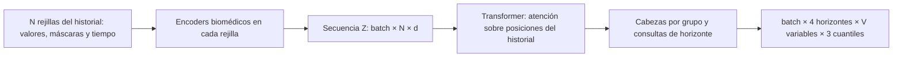

# Plan de comparación: secuencia de rejillas latentes y ensemble final

14 de noviembre de 2026. Este plan incorpora la aclaración del usuario y ordena las siguientes comparaciones. No se ejecutan nuevos entrenamientos, cambios de arquitectura ni ensemble al redactarlo. La arquitectura principal conserva todas las posiciones de la ventana como secuencia.

## 1. Arquitectura solicitada y estado comprobado

Para cada persona/origen, dividir el historial en N intervalos. En cada intervalo, los encoders biomédicos transforman los grupos de variables y una fusión produce un latente de ese intervalo. La secuencia completa de N latentes alimenta la atención temporal y las cabezas generan cuantiles por variable/horizonte.

**Eso ya sucede en el eje temporal del modelo actual.** Se verificó con una ejecución de formas sobre dos ventanas reales:

- Cada grupo entra como `[B,24,F_grupo]` y sale de su MLP como `[B,24,16]`.
- La concatenación/fusión opera en cada instante, produciendo `[B,24,16]`.
- El Transformer recibe y conserva `[B,24,16]`.
- Las consultas de 1/4/8/24 h atienden a las 24 posiciones de la memoria. Las salidas combinadas son `[B,4,34,3]`.

**16 es la dimensión por rejilla; no un único vector que sustituye toda la ventana.** La explicación anterior sobre compresión no debía sugerir un colapso del eje temporal. La posible pérdida de detalle se refiere a fusionar grupos en cada instante, no a descartar los N pasos antes del Transformer.

Para 24 h a 15 min, **N=96**. Hoy N=24 porque la fuente entrenada contiene filas horarias. El Transformer base admite longitud variable; el constructor horario actual usa explícitamente 24 slots y necesita parametrizarse para otras resoluciones. Los archivos descargados de una fila/hora no permiten recuperar mediciones reales ni extremos de 15 min.

| Resolución de entrada | Posiciones en 24 h | Desplazamientos equivalentes para 1/4/8/24 h |
|---|---:|---|
| 1 h, disponible | 24 | 1 / 4 / 8 / 24 intervalos |
| 15 min, candidata con datos adecuados | 96 | 4 / 16 / 32 / 96 intervalos |

Los cuatro horizontes de salida son independientes de las N posiciones de entrada. Tener 96 entradas no obliga a predecir 96 pasos futuros. Cada objetivo corresponde al intervalo terminal que acaba en t+h, según lo confirmado por el usuario.

## 2. Contrato común para todas las comparaciones

- Usar los mismos episodios, orígenes, intervalos objetivo, variables y máscaras para comparar una variante con otra.
- Los encoders actúan por rejilla y mantienen la secuencia; las estadísticas auxiliares o conexiones residuales son rutas adicionales, no sustituyen la secuencia latente.
- Agregados de entrada causales; medias/mínimos/máximos intraintervalo solo cuando existen mediciones originales que los permiten. Conservar recuentos, ausencia, calidad, antigüedad y tiempo.
- Diferenciar observación nueva, último estado causal conocido y padding. Los estados conservados no se convierten en mediciones nuevas ni etiquetas.
- Ajustar normalizadores y transformaciones exclusivamente en entrenamiento. Seleccionar modelos/configuraciones en desarrollo. La prueba publicada queda como comparación exploratoria; la confirmación final debe usar episodios nuevos no empleados en estas decisiones.
- Mantener orden de cuantiles, unidades y soporte por variable. Cualquier modificación de restricciones se declara antes de comparar y se evalúa con una regla coherente entre modelos.

## 3. Fases y comparaciones propuestas

### Fase A — Cerrar y parametrizar la representación de rejillas

Parametrizar duración de ventana y resolución, eliminando el supuesto fijo de 24 posiciones del constructor. Registrar siempre N real, rejillas existentes, observaciones por variable y posiciones de padding. Añadir pruebas de dimensiones para 24 y 96 posiciones, causalidad y equivalencia entre ejecución individual y por lotes. Una prueba de software con 96 posiciones no se presentará como entrenamiento con datos de 15 min.

Mantener inicialmente 24 h/1 h en datos reales para comparar modelos. Incorporar 24 h/15 min cuando una fuente identificada, densa y suficientemente larga respalde esa resolución y las etiquetas futuras. Auditar antes cuántas personas/ventanas quedan por horizonte. Para contrastar resolución, usar orígenes y objetivos temporalmente equivalentes; no cambiar a la vez fuente, resolución y familia de modelo y atribuir el resultado a una sola causa.

### Fase B — Completar las referencias tabulares

| ID | Modelo | Representación inicial | Pregunta |
|---|---|---|---|
| B0 | Persistencia | Último valor y edad | ¿Cuánto aporta superar el estado reciente? |
| B1 | Lineal cuantílica, ya ejecutada | Resúmenes causales propios de la ventana | Referencia actual de desarrollo |
| B2 | Boosting cuantílico | Mismos resúmenes que B1 | ¿Aporta no linealidad con las mismas entradas? |
| B3 | Bosque de regresión cuantílica | Mismos resúmenes que B1 | ¿Aporta otra forma de estimar cuantiles condicionales? |

Después estudiar características multiescala y retardos explícitos de grupos relacionados como una comparación separada. Los árboles también pueden consumir retardos ordenados convertidos en columnas; no reciben atención temporal, pero sí pueden aprovechar datos históricos. El RF ordinario de media no se convertirá en un modelo cuantílico tomando sin justificación percentiles de predicciones medias de árboles.

### Fase C — Comparar variantes que mantienen la secuencia completa

| ID | Variante | Qué permanece | Cambio que se aísla |
|---|---|---|---|
| T0 | Transformer compartido + cabezas por grupo | `[B,N,d]`, encoders, tiempo y máscaras | Implementación de referencia actual |
| T1 | Transformer por cabeza de salida | Cada cabeza recibe todos los N latentes comunes | Memoria temporal compartida frente a especializada por grupo |
| T2 | Atención completa dentro del historial disponible | Los mismos N pasos, cabezas y latente | Máscara interna causal frente a encoder bidireccional solo sobre el pasado ya conocido |
| T3 | Residual sobre el mejor baseline de desarrollo | Secuencia completa y atención de T0 | Ruta directa del estado propio/resúmenes + corrección aprendida |
| R0 | GRU con readout compartido, ya ejecutada | Mismos N pasos, encoders y readout con atención | Referencia de memoria recurrente |

Orden propuesto: B2/B3 → asegurar representación parametrizable → T0 frente a T3 → T1/T2 si el diagnóstico y presupuesto lo justifican. No ejecutar todas las combinaciones cartesianas.

En T2 todo el historial de la ventana termina antes o en el origen t y ya está disponible. Permitir que posiciones históricas se atiendan entre sí no introduce por sí mismo información posterior a t. Sin embargo, el encoder debe recibir una ventana previamente truncada/filtrada: en una API con cortes intermedios, enmascarar solo el decoder no evita que un encoder bidireccional incorpore posiciones posteriores al corte. Se exigirá un test específico antes de entrenar esa variante.

La propuesta T1 se aproxima explícitamente a cabezas Transformer especializadas que leen la secuencia latente común. La implementación actual, T0, añade una memoria temporal compartida antes de los decoders específicos. Esta distinción queda documentada y no se confunde con la existencia o ausencia de la secuencia de N latentes.

### Fase D — Capacidad, ventana y representación de grupos

Solo tras fijar una variante candidata:

1. Comparar latente 16/32/64, con presupuesto declarado y una lista pequeña de configuraciones.
2. Contrastar ventanas 6/12/24 h sobre orígenes comunes y mantener visibles los contextos parciales.
3. Si fusionar todos los grupos en cada rejilla parece restrictivo, probar una representación que conserve tokens de grupo y tiempo, o atención separada entre grupos y entre tiempos. Registrar aumento de coste: N×G tokens no equivale a N tokens de un vector fusionado.
4. Evaluar preentrenamiento de encoders compatibles y, por separado, preentrenamiento temporal. Mantener una referencia entrenada desde cero y preservar las N posiciones tras transferir.

## 4. Evaluación y decisiones

Por variable, cabeza, horizonte, dominio y tipo de contexto: MAE de q50, pinball de cada cuantil, cobertura, anchura, soporte físico, etiquetas y episodios. Mantener gráficos de trayectorias/bandas, mapas por variable/horizonte, curvas de ajuste y casos sin historia propia. Si se muestran atenciones, son pesos del modelo, no explicaciones causales demostradas.

Elegir checkpoints y arquitectura en desarrollo. Un resultado de una única semilla es inicial; confirmar estabilidad con repeticiones o validación por grupos antes de cerrar el candidato. Mantener las variables difíciles visibles y marcar evidencia escasa. Aumentar N no garantiza una mejora: el experimento debe comprobar qué información adicional aportan observaciones reales.

## 5. Ensemble: fase final

El usuario solicita combinar modelos al final. Se hará cuando existan candidatos individuales estables y se haya medido si sus errores son complementarios en desarrollo/predicciones fuera de pliegue.

1. Referencia de combinación simple con pesos iguales y candidatos elegibles.
2. Aprender pesos no negativos normalizados o un stacking pequeño con predicciones fuera de pliegue por episodio generadas dentro del desarrollo del sistema. Ninguna etiqueta de prueba ni del conjunto reservado para calibrar el ensemble se usa para entrenar estos pesos.
3. Con poco soporte, preferir pesos compartidos globales o por cabeza a cientos de pesos independientes por variable/horizonte. Justificar la especialización con datos.
4. Conservar orden de cuantiles; si se promedian cuantiles con los mismos pesos no negativos para q10/q50/q90 se conserva el orden. Esa operación es una agregación de cuantiles y **no equivale en general a obtener los cuantiles de una mezcla de distribuciones**.
5. Congelar candidatos y pesos. Calibrar la salida combinada con el conjunto reservado cuando exista soporte y después evaluar una prueba final independiente. Que un ensemble mezcle modelos no garantiza superar al mejor individual.

El dashboard final mostrará modelos individuales y ensemble, con pesos/versión, disponibilidad, métricas y bandas. No se ha construido ni entrenado un ensemble en esta fase de planificación.

## Próxima ejecución prevista

Completar las referencias de árboles y parametrizar el contrato de secuencia; aplicar después las variantes temporales seleccionadas manteniendo siempre `[B,N,d]`. Los resúmenes, estados persistentes y rutas residuales se tratarán como comparaciones o entradas auxiliares de esa arquitectura. El ensemble queda expresamente al final.
